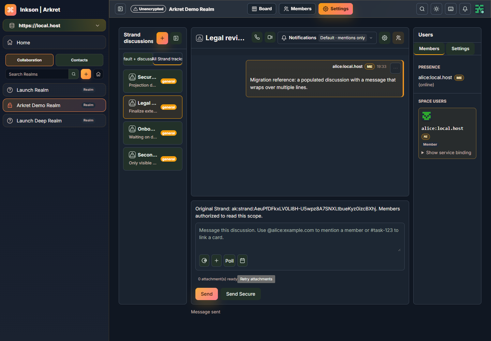
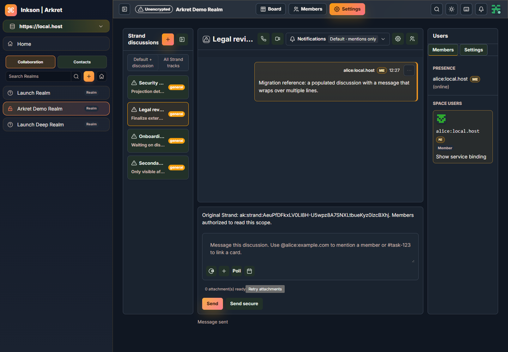
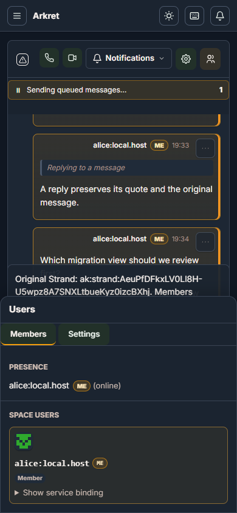
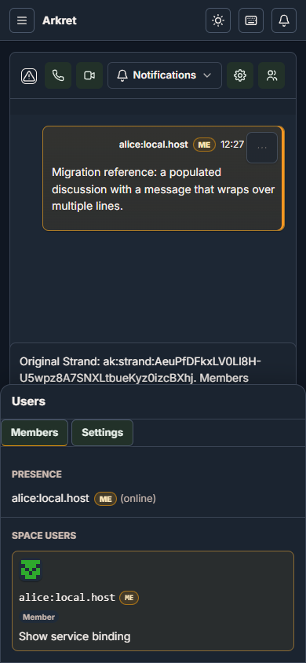
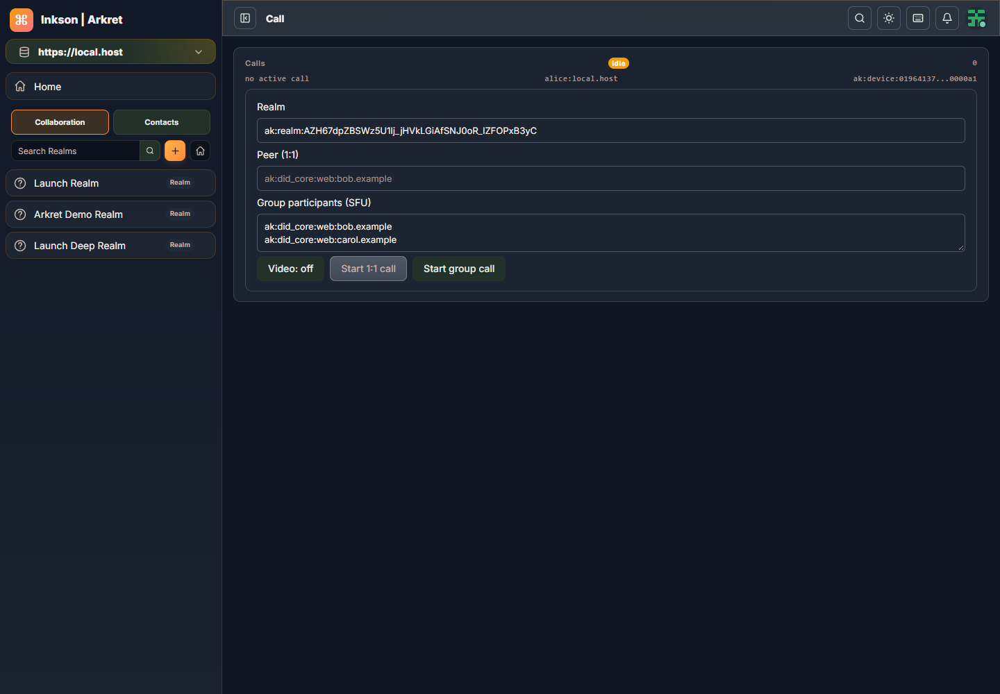
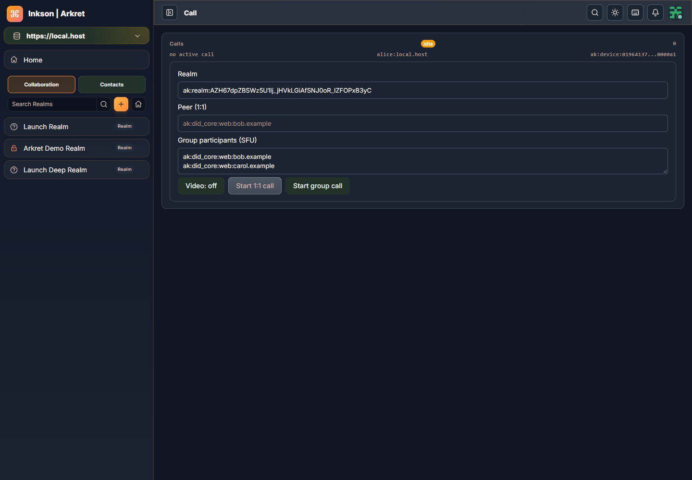
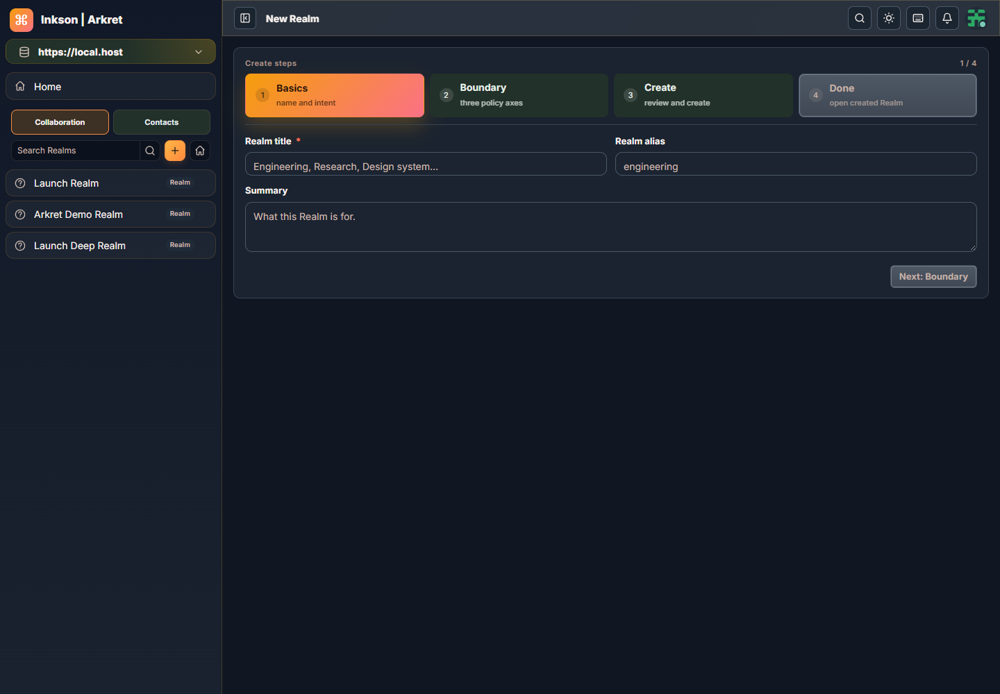
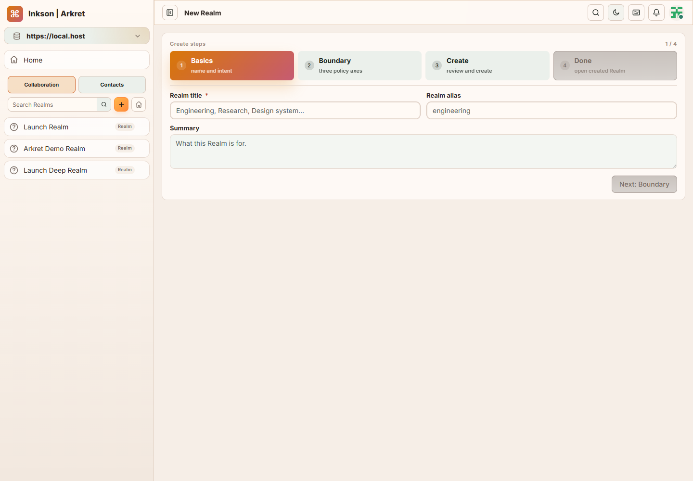
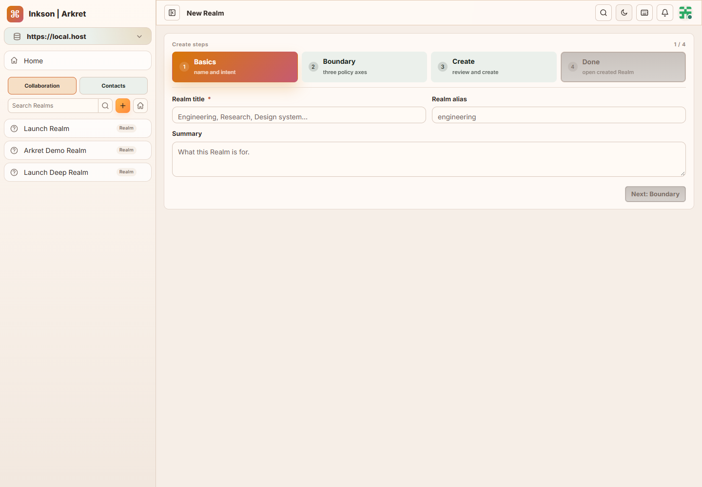

# Glory/Sapid 迁移验收

修改前已更新远端，原版参照为 `0950b356`。迁移实现提交为 `1679fe44`，生产配置导入清理为 `2f498720`。后者只收紧夹具导入及局部可变绑定的编译条件，不改变请求、授权、时效或界面逻辑。

Glory、Sapid 使用官方 GitHub main，并由 Cargo.lock 分别锁定 `b9d06545c701510ba18d5cdb7cd363c102cad906`、`c5c4e23aeb6d37b3f2537545116bac43dbb40a64`。实际依赖图没有 Dioxus/Yoface，没有本地 UI 路径覆盖。构建、缓存及临时文件均位于 D 盘。

## 已执行的检查

| 检查 | 实际结果与范围 |
| --- | --- |
| 原有 126 个 E2E 场景 | 分组及必要补验均取得通过记录，见下表；不是一次同包126场景整跑 |
| 原生全套42 | 2562单元通过、1项容量profile保留忽略；68集成通过，其中含文案门禁5项；3个文档示例保留忽略 |
| 最终原生46 | all-targets/all-features 严格Clippy通过；desktop dev程序与资源构建通过 |
| 真Chrome WASM45 | MLS1、IndexedDB13、Group1、Receipts4、WriteState1，共20通过；原120秒期限，源码/依赖/环境前后一致 |
| 协议fixture | 256契约与21前置门禁通过；不代表实际服务的原生authority ledger验收 |
| 恢复弹窗助手 | 5个独立真实浏览器边界通过，单独计数 |
| 最终生产Web46 | release、仅web功能构建通过，编译警告0；真实生产登录页桌面/手机及深浅媒体偏好4项通过，无页面错误或横向溢出 |
| 其他门禁 | 最终格式、Git空白、删除门禁、SDK wire类型归属检查通过；资源完整性和构建工具检查已执行 |

| E2E分组 | 保留的整组记录 | 必要补验 |
| --- | --- | --- |
| 设置/账户/创建/管理34项 | 40：30通过、4失败 | 41：原4项全部通过；步骤导航另验通过 |
| 通知/Direct/导航31项 | 41：30通过、1失败 | 44：原完整Dashboard场景通过 |
| Dashboard/Station/Viewport/Auth26项 | 41：24通过、2失败 | 43：安全标识完整1项通过；44：原完整登录导航项通过 |
| 搜索/Chat/Kanban等35项 | 41：33通过、2失败 | 44：原完整Direct及Kanban多语言2项通过 |

原失败、trace和具体版本均保留，没有放宽业务期限、强制点击或删除安全断言。Auth补验恢复了原Sidebar→Topbar顺序，并修复只读安全提示浮层遮挡链接的问题。Direct保留13个真实操作和值的精确校验，另明确检查新host的隐藏禁用占位项。

## 原版与新版对照

以下为实际原像素图片，完整哈希与视口见 [图片及产物索引](glory-migration-evidence.json)。对照确认主要布局基本对应；控件间距、字体渲染等仍有小差异，不宣称逐像素一致。Chat是实际收到MessageCreate200后的有消息场景；Call仅为空闲表单，没有验收媒体连通。

| 场景 | 原版0950b356 | Glory/Sapid |
| --- | --- | --- |
| Chat桌面1440×1000 |  |  |
| Chat手机390×844 |  |  |
| Call桌面1440×1000 |  |  |
| 创建步骤深色 |  |  |
| 创建步骤浅色 |  |  |

步骤条43实际深浅背景、文字、边框及hover与旧版严格相等。Chat45只恢复旧Secondary控件的填充色；18个实际控件同DOM位置/尺寸最大变化0px，主按钮和active Strand外观保持。该画面没有动态disabled样本，禁用控件由选择器排除，不宣称另验动态disabled状态。首次样式诊断的跨端口字体CORS失败已保留；最终使用同源对照并重新打开真实45页面截图。

本机历史矩阵有40页四组合160张图及手机正文补图。原版参照中6个RealmAdmin页仅有源码，原版浅色全页矩阵不完整；最终未把40页全部重拍。Privacy手机对照来自39，未冒称最终46截图。

## 原生范围与产物

Web保持真实RichEditor。当前原生host不支持RichEditor，保留草稿、明确提示并提供用户选择的手动Markdown编辑；音视频附件使用下载/外部播放，GIF仅首帧，原生右键菜单手势也有差异。Native SFU保留真实LiveKit Wry子进程；P2P仍为原有不可用状态。详细边界见 [host与owner说明](glory-host-ownership.md)。用户停止computer use后没有继续物理窗口操作；Memory/Blitz及headless结果不等同于物理桌面或连通媒体验收。

本地Web发布验证包由 `.ci/package-release.py` 生成并附SHA256；原生包是明确标注dev的Windows验证包。Windows原生构建仍保留Cargo的inkson.pdb文件名冲突提示，实际编译/链接成功。未运行Docker、真实OAuth/数据库部署或远端CI验收。

完整原始日志、trace、构建指纹与历史图片位于本机被Git忽略的 `artifacts/glory-migration`，主要入口为 `final/` 与 `tooling/`。构建及E2E复现命令见 [README](../README.md) 和 [RELEASING](RELEASING.md)。
